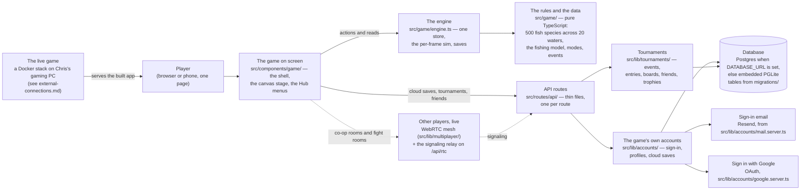

# Relational map — FAC Ultra

How the whole game connects, in plain diagrams. This is the readable
system map required by the fleet rule adopted 2026-11-18 (see
`docs/RULES.md`). It describes the game **as built** — the root
`README.md` is the front door, `docs/README.md` is the docs index and
the settings list, and the design contract lives in
`docs/architecture/`.

Last refreshed: 2026-11-23, from `main`.

Every game module, component file, server file, API route file,
migration and tooling script has its own entry in
[`inventory/`](inventory/): [game modules](inventory/game.md),
[components](inventory/components.md), [server files](inventory/server.md),
[API routes](inventory/api.md), [migrations](inventory/migrations.md) and
[scripts](inventory/scripts.md). A change adds or edits only its own
entries (one per item, a blank line between), and
`scripts/check-map-inventory.mjs` checks every item has one. The
diagrams below show how the pieces connect.

## The system in one picture

## How the pieces hold together

- **Two kinds of state, kept apart on purpose.** The React screens
  read the Zustand store in `src/game/engine.ts`; the canvas reads a
  plain mutable `sim` object that changes every frame and is never
  saved. `src/components/game/stage.tsx` calls the engine's frame
  tick once per animation frame, then paints.
- **The rules never live in screens.** Everything a screen shows is
  computed in `src/game/` (pure TypeScript, tested beside the code);
  components only draw and dispatch. The design contract's own
  [codebase map](../architecture/02-codebase-map.md) says where new
  work plugs in.
- **Saves are the game's own format.** A save is versioned
  (`SAVE_VERSION` in the engine), sanitized and migrated on load, and
  kept per mode and per slot — on the device first, and in the cloud
  when the player signs in. The saved-game fixtures under
  `src/game/__fixtures__/` must always load.
- **The server checks what matters.** Tournaments are scored again
  on the server from the same rules code the client runs
  (`src/game/replay.ts`, `src/game/scoring.ts`), so a edited client
  cannot invent a score. Co-op play is the opposite on purpose:
  browsers talk to each other directly and the server only relays
  the introductions.
- **One database, two engines.** `src/lib/db.ts` gives every server
  file the same `getSql()`: a real Postgres when `DATABASE_URL` is
  set, the embedded PGLite otherwise. The same migrations run on
  both.
- **Two sign-ins, never mixed up.** The game's own accounts
  (`src/lib/accounts/`) are the players' accounts. The Better Auth
  wiring in `src/lib/auth/` belongs to the Grok sandbox platform the
  game was built in — it is not the game's accounts, and the game's
  work leaves it alone.
- **Updates never wipe progress any more.** The old test-phase
  reset is off by default, so a routine update keeps every player's
  data; its machinery stays for testing the reset itself (the story
  is in [docs/TEST-PHASE.md](../TEST-PHASE.md)). A player who wants
  a fresh start clears one of their own profiles instead: the cloud
  saves are kept first as that profile's one backup, restorable for
  a day — see [server-and-accounts.md](server-and-accounts.md).

## Areas

| File | Area |
|---|---|
| [runtime-and-routes.md](runtime-and-routes.md) | How the game boots, the page and API routes, the PWA chrome, previews |
| [game-and-data.md](game-and-data.md) | The rules layer, the content tables, modes, saves and migrations |
| [server-and-accounts.md](server-and-accounts.md) | The database, the game's accounts and cloud saves, tournaments, live rooms |
| [external-connections.md](external-connections.md) | The PC hub hosting, email, Google sign-in, the database outside, the sandbox platform |

## Running and releasing

- Checks: `npm test` runs the map checks first, then the whole test
  suite; CI (`.github/workflows/ci.yml`) runs typecheck, lint, test
  and build on every pull request.
- The live game is hosted on Chris's gaming PC, not on a cloud
  account: merging to `main` does not deploy by itself — the hub is
  redeployed from `main` by the deploy script on the PC (see
  [external-connections.md](external-connections.md)).
- Open gaps and untested areas are collected in
  [docs/KNOWN-GAPS.md](../KNOWN-GAPS.md), not in this map.
